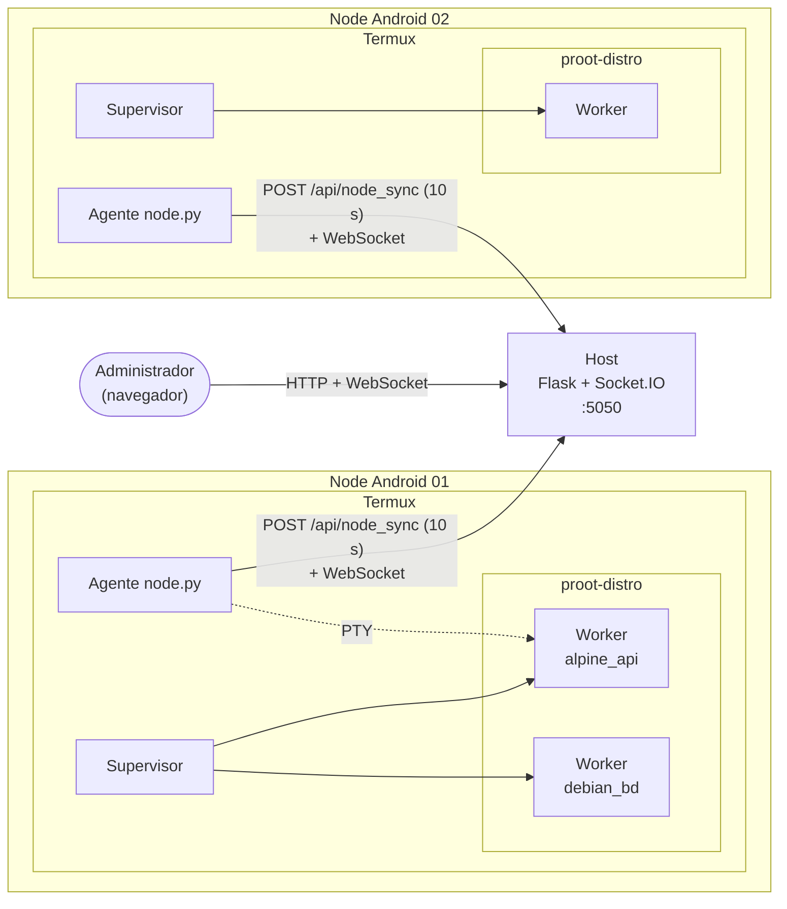
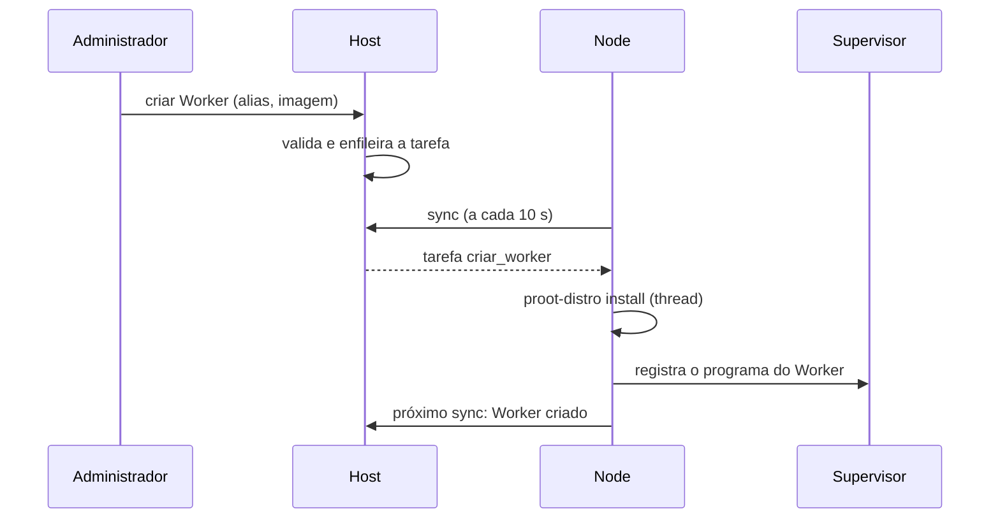

# 5. Prototipação e Implementação

## 5.1 Visão geral

Um Host (PC ou servidor) controla vários Nodes Android. Em cada aparelho, o Termux executa o agente e o `proot-distro`, que hospeda os Workers mantidos pelo Supervisor (Figura 1). O código está no repositório do projeto: o Host em `desktop/` e o agente em `android/`.

*Figura 1 — Arquitetura do DroidServer em operação. As setas partem de quem inicia a conexão: o sync e o terminal são iniciados pelo Node; o Host só contata o Node (porta 5051) para a varredura e o pareamento.*

## 5.2 Protocolo de comunicação

**Cadastro.** O painel encontra e adiciona os Nodes. O agente abre uma porta de descoberta (5051/TCP), o Host varre a rede local (uma `/24` em 3,2 s) e, ao "Adicionar", envia ao celular um *token* exclusivo. O Node passa a ser identificado pelo *token*, e não pelo IP, que muda a cada *reboot* (DHCP). O endereço do Host é tirado da própria conexão de pareamento, e um Node pareado só aceita novo pareamento do mesmo Host.

**Sincronização.** A cada 10 s, o agente envia `POST /api/node_sync` com seus Workers e o estado de cada um, os resultados das tarefas concluídas, a CPU e a memória e o *token*. O Host atualiza o painel e responde com as tarefas pendentes daquele Node. A lista de Workers é sempre a que o Node reporta: o Host não a altera por conta própria.

**Terminal.** As teclas digitadas no navegador vão ao Host por WebSocket, que as repassa ao Node. Na primeira tecla, o agente abre um PTY com `proot-distro login <alias>`. A saída faz o caminho inverso. Os comandos e os logs da aba Serviço usam o mesmo WebSocket, de modo que um botão responde em menos de 1 s, sem esperar o *sync*.

## 5.3 Ciclo de vida de um Worker

*Figura 2 — Criação de um Worker. A instalação roda numa thread do agente, sem bloquear o sync.*

A criação roda em uma *thread* separada, porque `proot-distro install` pode demorar minutos e o *sync* não pode parar (Figura 2). Cada Worker vira um programa do Supervisor com `autostart` e `autorestart`, executado com `proot-distro login --isolated` (o Worker não enxerga o *home* do Termux nem o `/sdcard`) e com `ulimit` de arquivos e processos, o único limite disponível sem *cgroups*.

Cada Worker roda **um serviço: o arquivo `/app/run.sh`**. Um lançador espera esse arquivo existir e o executa em primeiro plano, de modo que basta criá-lo para o serviço subir. Pela aba **Serviço** do painel, o administrador edita o `run.sh`, inicia, para e reinicia o serviço, acompanha os logs ao vivo e vê o endereço, as falhas do dia e o consumo de CPU, RAM e disco. A remoção faz o caminho inverso: para o serviço, encerra as sessões e executa `proot-distro remove`.

## 5.4 Monitoramento e registro local

Sem *root*, o SELinux do Android 16 nega a leitura de `/proc/stat`, e nos dois aparelhos usados (Android 16 e 11) é negada a leitura da temperatura e da bateria em `/sys/class`. Por isso, a CPU é medida somando o tempo de processador (`utime + stime`) dos processos do Termux, normalizado pelo número de núcleos. Em testes com carga controlada, essa medida acompanhou a carga gerada (25% → 22,9%, 50% → 49,8%). A CPU de cada Worker considera só o processo do serviço e seus descendentes.

O Host é apenas o plano de gerenciamento e pode ser desligado. A cada ciclo, o agente primeiro mede e grava a amostra no próprio celular (cerca de uma semana de histórico) e só depois tenta sincronizar. Quando o painel volta, recebe os últimos 30 minutos. Isso foi validado no moto e40: com o Host desligado, o serviço continuou no ar e o registro seguiu sem lacunas.

## 5.5 Decisões de projeto e qualidade

As principais decisões foram: (1) **polling iniciado pelo Node**, que funciona atrás de NAT e tolera o *Doze*, ao custo de até 10 s para uma tarefa começar; (2) **Supervisor** em vez de processos soltos, para reiniciar serviços que caem, já que não há `systemd`; (3) **`--isolated` e `ulimit`** como o isolamento possível sem *cgroups*; e (4) **segurança mínima para uma LAN confiável**: *token* por Node, validação dos nomes dos Workers contra injeção de comandos, verificação de `Origin` contra CSRF e uma senha do painel **opcional**, definida pela variável `DROID_PANEL_PASSWORD`. Sem essa variável, que vem desligada por padrão, o painel e o terminal ficam abertos a quem alcançar a porta do Host, e o Host emite um aviso ao iniciar. Não há TLS. O modelo de ameaça, portanto, é o de uma rede local em que todos os dispositivos são confiáveis; atacantes na própria rede e a exposição à Internet estão fora do escopo. Não ficou registrado se a senha estava definida nos experimentos, o que não afeta os resultados, porque nenhum deles mede autenticação.

Na versão avaliada (*commit* `3cd3e58`), o projeto tinha 233 testes automatizados com `pytest` (87 no Host e 146 no agente), contados com `pytest --collect-only`. Eles usam *mocks* de `subprocess`, `pty` e `requests` e por isso rodam em qualquer Linux, fora do Android. Com as funções posteriores, fora do escopo (seção 1.5), o *commit* `b7be872` soma 366 testes (125 e 241).

## 5.6 Interface

O painel é uma página única servida pelo Host, com três níveis: o *Dashboard* (todos os Nodes), a página de cada Node (seus Workers) e a página de cada Worker, com as abas **Serviço** e **Terminal**.

![[figuras/painel_dashboard.png]]

*Figura 3 — Dashboard: Nodes com estado, CPU do DroidServer e RAM, e o gráfico de uso em tempo real aberto para o moto e40.*

![[figuras/painel_servico.png]]

*Figura 4 — Aba Serviço: endereço, falhas e recursos, editor do /app/run.sh e logs ao vivo.*

O *Dashboard* (Figura 3) mostra cada Node com o estado, a CPU e a memória e permite cadastrar Nodes novos. A aba Serviço (Figura 4) põe uma aplicação no ar sem usar o terminal. O terminal é um *shell* dentro do Worker, como numa VPS acessada por SSH.
