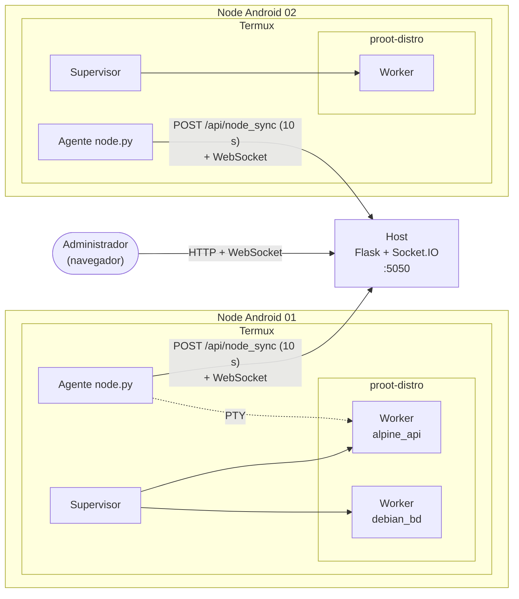
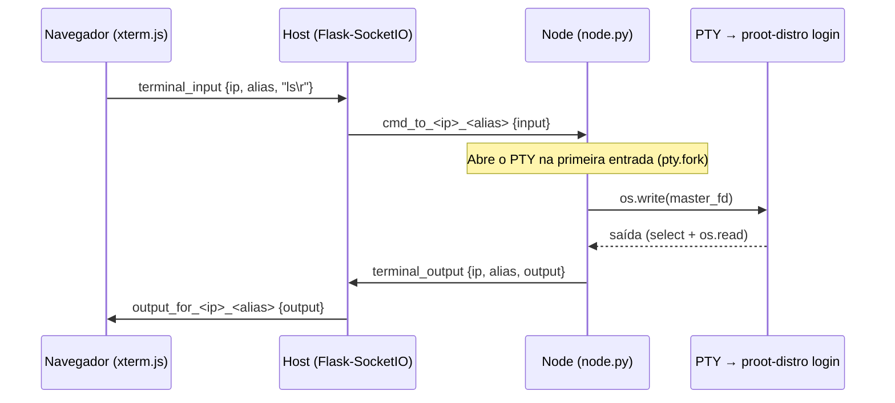

# 8. Prototipação e Implementação

Este capítulo descreve o protótipo implementado no repositório DroidServer: seus componentes, o protocolo de comunicação e os principais fluxos.

## 8.1 Visão geral

Um Host (PC ou servidor) controla vários Nodes Android. Em cada aparelho, o Termux executa o agente e o `proot-distro`, que hospeda os Workers mantidos pelo Supervisor.



*Figura 1 — Arquitetura do DroidServer em operação. As setas partem de quem inicia a conexão: o sync e o terminal são iniciados pelo Node; o Host só contata o Node (porta 5051) para a varredura e o pareamento (Figura 2).*

## 8.2 Componentes

| Componente | Arquivo | Responsabilidade |
|---|---|---|
| Servidor Host | `desktop/app/__init__.py`, `desktop/main.py` | Cria a aplicação Flask, o Socket.IO e os *logs* rotativos; escuta em `0.0.0.0:5050` |
| API e eventos | `desktop/app/routes.py` | Registro de Nodes, fila de tarefas, detecção de *offline*, retransmissão do terminal |
| Painel (SPA) | `desktop/app/templates/index.html` | *Single Page Application* com três telas: Dashboard, Node e Terminal |
| Agente | `android/node.py` | Classes `Config`, `WorkerManager`, `TerminalManager` e `NodeAgent` |
| Métricas | `android/sysinfo.py` | CPU (delta de `/proc/stat` ou `top`) e memória (`/proc/meminfo`) |
| Instalação | `android/setup.sh` | Pacotes, Supervisor, `supervisord.conf`, dependências, conexão, Termux:Boot |
| Execução | `android/run.sh` | Inicia o agente em primeiro ou segundo plano com reinício automático |
| Diagnóstico | `android/diagnostico.sh` | Coleta estado do `/proc`, `proot-distro`, Supervisor e *logs* |

## 8.3 Protocolo de comunicação

### 8.3.0 Cadastro dos Nodes (iniciado pelo painel)

Nas primeiras versões, cada celular precisava ser configurado com o IP do Host, e o Host aceitava qualquer Node que se apresentasse. Isso tinha dois problemas observados no aparelho de testes: o administrador precisava digitar o IP do Host em cada celular, e o celular mudava de IP a cada *reboot* (DHCP: `.7 → .4 → .7`), o que criava registros duplicados no painel.

A versão atual inverte o cadastro: **o painel encontra e adiciona os Nodes**. O agente abre uma porta de descoberta (5051/TCP) que responde apenas à identificação (`GET /droidserver`) e ao pareamento (`POST /parear`, `POST /desparear`).

```mermaid
sequenceDiagram
    participant A as Administrador
    participant H as Host
    participant N as Node (porta 5051)
    A->>H: Varrer 192.168.1.0/24
    loop 254 endereços, 64 em paralelo
        H->>N: GET /droidserver
        N-->>H: {modelo, android, pareado}
    end
    A->>H: Adicionar 192.168.1.7
    H->>H: gera token exclusivo (secrets.token_hex(24))
    H->>N: POST /parear {host_port, token}
    N->>N: host = IP de origem do pedido; salva pareamento.json (0600)
    N-->>H: ok
    H->>H: salva nodes.json (0600)
    loop a cada 10 s
        N->>H: POST /api/node_sync {..., token}
        H-->>N: tarefas (ou 401 se o token não for de um Node cadastrado)
    end
```

*Figura 2 — Descoberta e pareamento de um Node.*

Decisões:

- **O endereço do Host vem do próprio pedido de pareamento** (IP de origem da conexão TCP), e não de um campo enviado: um terceiro não consegue apontar o Node para outra máquina.
- **O Node é identificado pelo token, não pelo IP.** Se um sync chega com um token cadastrado e um IP diferente, o Host move o cadastro, o estado e o histórico para o novo IP.
- **Um Node pareado só aceita novo pareamento do mesmo Host** e só o Host pareado, com o token, pode desfazê-lo.
- **Depois do pareamento, a operação continua iniciada pelo Node** (sync e WebSocket), o que preserva a tolerância às restrições de energia do Android discutida em 5.6.

Medições no aparelho (15/11/2026): a varredura de uma `/24` levou **3,2 s**; após "Adicionar", o Node apareceu *Online* com seus 4 Workers em ~10 s; reiniciar o Host não exigiu readicionar (cadastro persistido); um pedido de pareamento vindo de outro endereço foi recusado.

### 8.3.1 Sincronização (HTTP, iniciada pelo Node)

A cada `POLL_INTERVAL = 10 s`, o agente envia:

```json
POST /api/node_sync
{
  "ip": "192.168.0.23",
  "status": "Online",
  "workers": ["alpine_api", "debian_bd"],
  "worker_status": {"alpine_api": "RUNNING", "debian_bd": "STARTING"},
  "tarefa_atual": {"acao": "criar_worker", "alias": "debian_dev", "imagem": "debian"},
  "resultados": [{"acao": "deletar_worker", "alias": "teste", "ok": true, "msg": "...", "ts": "14:02:11"}],
  "cpu": null,
  "cpu_termux": 25.0,
  "cpu_workers": {"alpine_api": 24.9, "debian_bd": 0.0},
  "mem": {"total": 3876544512, "usado": 2147483648, "percent": 55.4},
  "token": "opcional"
}
```

O Host atualiza o registro do Node, emite `node_updated` aos painéis abertos e responde com as tarefas pendentes, esvaziando a fila daquele Node:

```json
{"status": "ok", "tarefas": [{"acao": "criar_worker", "alias": "debian_dev", "imagem": "debian", "isolado": true}]}
```

A lista de Workers é **autoritativa do Node**: o Host nunca a altera de forma otimista, apenas exibe o que o aparelho reporta.

### 8.3.2 Terminal (WebSocket)

| Origem → destino | Evento | Conteúdo |
|---|---|---|
| Navegador → Host | `terminal_input` | `{ip, alias, input}` |
| Host → Node | `cmd_to_<ip>_<alias>` | `{input}` |
| Navegador → Host | `terminal_resize` | `{ip, alias, cols, rows}` |
| Host → Node | `resize_to_<ip>_<alias>` | `{cols, rows}` |
| Node → Host | `terminal_output` | `{ip, alias, output}` |
| Host → Navegador | `output_for_<ip>_<alias>` | `{output}` |



*Figura 3 — Fluxo de uma tecla no terminal remoto.*

## 8.4 Ciclo de vida de um Worker

```mermaid
sequenceDiagram
    participant A as Administrador
    participant H as Host
    participant N as Node
    participant S as Supervisor
    A->>H: POST /deploy_worker {ip, alias, imagem, isolado}
    H->>H: valida alias/imagem e enfileira "criar_worker"
    N->>H: POST /api/node_sync
    H-->>N: tarefas: [criar_worker]
    N->>N: fila interna (thread) — não bloqueia o polling
    N->>N: limpa resíduos do alias; proot-distro install <imagem> --override-alias <alias>
    N->>S: grava conf.d/<alias>.conf; supervisorctl reread/update
    N->>N: injeta /app/run_server.sh (base64)
    N->>H: próximo sync: resultados [✓ criado], worker_status RUNNING
```

*Figura 4 — Criação de um Worker.*

O serviço gerado para o Supervisor tem a forma:

```ini
[program:alpine_api]
command=sh -c 'ulimit -n 4096 2>/dev/null; ulimit -u 1024 2>/dev/null; exec proot-distro login --isolated alpine_api -- /app/run_server.sh'
autostart=true
autorestart=true
startsecs=5
```

A remoção segue o caminho inverso: encerra a sessão de terminal, para o serviço, remove o `.conf`, encerra as sessões restantes do container (`proot-distro kill`), executa `proot-distro remove` — com novas tentativas, pois o comando falha de imediato se alguma sessão ainda segura o *lock* do container — e apaga os *logs*.

## 8.5 Monitoramento de recursos

No aparelho de testes (Android 16, sem *root*), o SELinux nega a leitura de `/proc/stat` e `/proc/loadavg`, de temperatura e de bateria, e o `top` do sistema exibe 100% ocioso. Duas fontes permanecem acessíveis e foram avaliadas com cargas controladas (laços infinitos em 2, 4 e 8 núcleos, janelas de 6 s):

| Carga gerada | `cpuidle` (tempo ocioso por núcleo) | Soma dos processos do Termux |
|---|---|---|
| 0% | 39–45% | 0,1% |
| 25% | 93% | 22,9% |
| 50% | 84% | 49,8% |
| 100% | 100% | 87,5% |

*Tabela 1 — Fontes de CPU acessíveis sem root. Fonte: medição do autor (Xiaomi 2311DRK48G, 15/11/2026).*

O tempo ocioso exposto em `cpuidle` foi descartado por não ser monotônico com a carga. Adotou-se a soma de `utime + stime` dos processos visíveis (mesmo UID do Termux), normalizada pelo número de núcleos e pelo intervalo entre amostras:

$$\text{CPU}_\%=100\cdot\frac{\sum_p \Delta(\text{utime}_p+\text{stime}_p)}{\text{CLK\_TCK}\cdot\Delta t\cdot N_\text{núcleos}}$$

A CPU de cada Worker considera apenas o processo do serviço no Supervisor (PID obtido do `supervisorctl status`), a sessão de terminal e seus descendentes. Com dois laços infinitos dentro de um Worker, o painel exibiu 25,0% no total e 24,9% no Worker. A métrica não inclui outros aplicativos do aparelho, e processos que nascem e morrem entre duas amostras não são contabilizados.

## 8.6 Decisões de projeto

| Decisão | Motivo | Consequência |
|---|---|---|
| *Polling* iniciado pelo Node | Funciona atrás de NAT; o Host não precisa conhecer nem alcançar o aparelho | Tarefas demoram até 10 s para começar |
| Fila de tarefas em *thread* | `proot-distro install` pode levar até 20 min (`INSTALL_TIMEOUT = 1200`) | O *sync* continua mesmo durante instalações |
| Supervisor em vez de processos soltos | Reinício automático; não há *systemd* no Android | Dependência extra; ajuste para Python sem `os.link()` |
| `--isolated` por padrão | Evita que o Worker veja o *home* do Termux e o `/sdcard` | Requer `proot-distro` recente |
| `ulimit` por Worker | Único limite disponível sem *cgroups* | Não limita CPU nem memória |
| Validação do alias (`^[A-Za-z0-9_-]{1,64}$`) no Host e no Node | O alias vira caminho, nome de serviço e nome de evento | Previne injeção de comandos e de caminhos |
| Cadastro de Nodes em disco; estado de operação em memória | O cadastro (tokens) precisa sobreviver a reinícios; o resto é refeito pelos syncs | Reiniciar o Host não exige readicionar Nodes |
| Node identificado por token, cadastrado pelo painel | O IP muda a cada reboot (DHCP); o celular não precisa saber o IP do Host | Um Node ainda não pareado aceita pareamento de qualquer máquina da LAN |
| Token opcional (`DROID_API_TOKEN`) | Restringir quais Nodes se registram | Enviado em texto claro (sem TLS) |

## 8.7 Garantia de qualidade

O projeto possui 124 testes automatizados com `pytest` (51 no Host e 73 no agente), usando o `test_client` do Flask, o `socketio.test_client` e *mocks* de `subprocess`, `pty`, `select` e `requests` — de modo que rodam em qualquer Linux, fora do Android. A suíte inclui testes de regressão para defeitos encontrados durante o desenvolvimento: perda de resultados de tarefas registrados durante uma sincronização, chamadas ao `supervisorctl` sem o arquivo de configuração do Termux e vazamento de descritores e processos-zumbi nas sessões de terminal.

## 8.8 Interface

*(Inserir capturas de tela: Dashboard com os Nodes e as barras de CPU/RAM; página do Node com o formulário de criação e os cartões de Workers; terminal com `htop` em execução dentro de um Worker.)*
